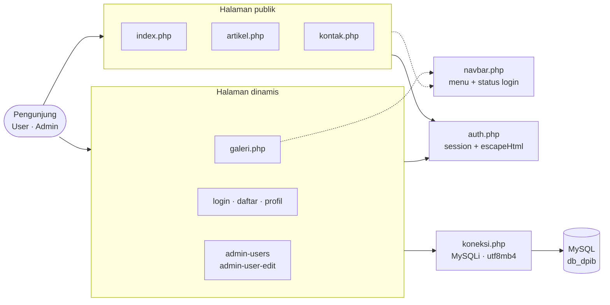
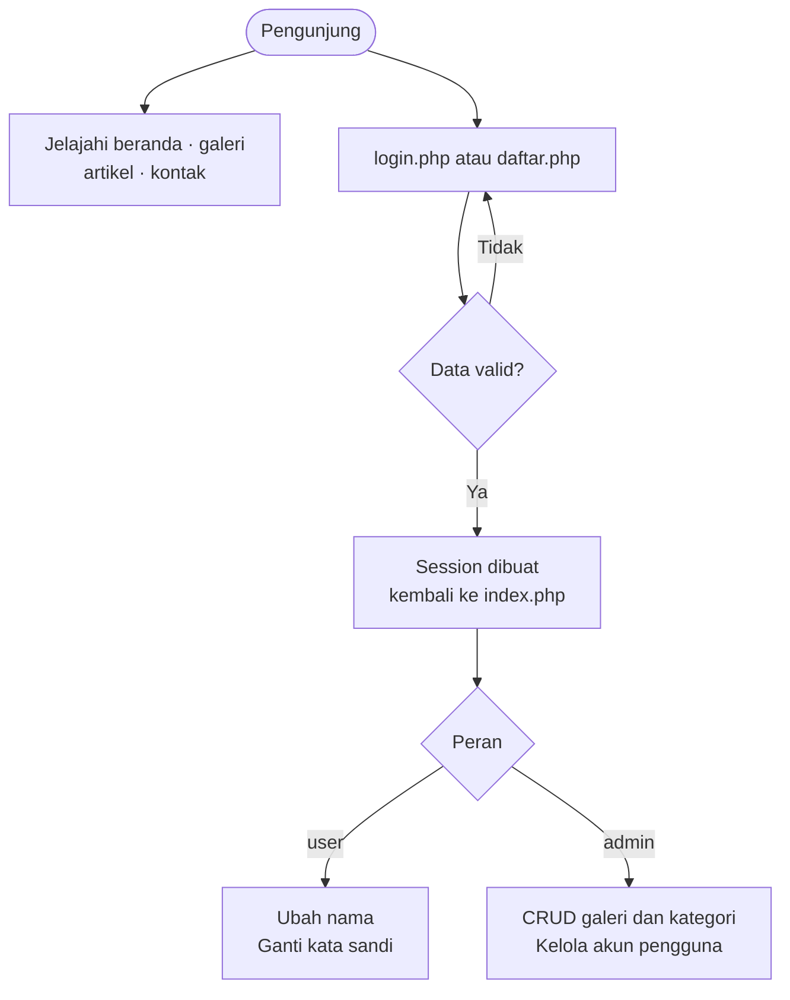
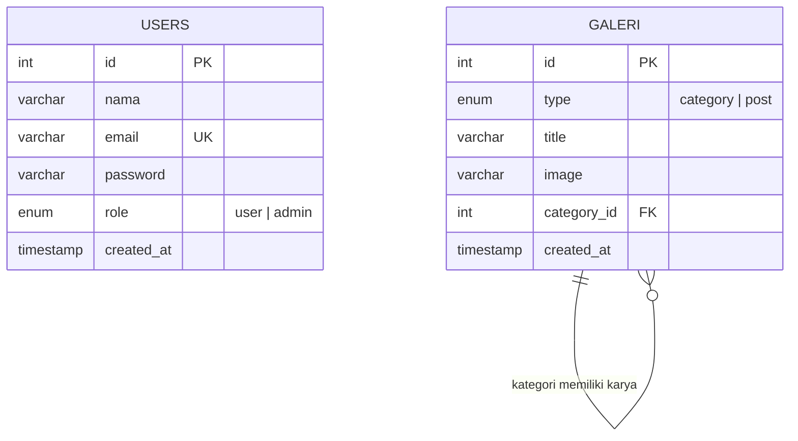

<div align="center">


### Profil Jurusan dan Sistem Informasi Portofolio Siswa!

*Presisi desain arsitektural, dipublikasikan untuk dunia.*

<br/>


<br/>

[Ringkasan](#ringkasan-proyek) &nbsp;•&nbsp;
[Fitur](#fitur-utama) &nbsp;•&nbsp;
[Arsitektur](#arsitektur-sistem) &nbsp;•&nbsp;
[Teknologi](#teknologi) &nbsp;•&nbsp;
[Instalasi](#instalasi) &nbsp;•&nbsp;
[Database](#skema-database) &nbsp;•&nbsp;
[Keamanan](#keamanan) &nbsp;•&nbsp;
[Roadmap](#roadmap) &nbsp;•&nbsp;
[Kontribusi](#kontribusi)

</div>

<br/>

---

## Ringkasan Proyek

**DPIB Web Portal** adalah aplikasi web untuk mempublikasikan profil, kompetensi keahlian, dan portofolio karya siswa jurusan **Desain Pemodelan dan Informasi Bangunan (DPIB)** di **SMK Negeri 1 Kawali**.

Antarmukanya mengusung gaya *architectural minimalism* dengan palet monokromatik dan tipografi bergaya *blueprint*. Di baliknya ada backend **PHP Native** dan **MySQL** yang menyediakan manajemen galeri karya (CRUD), akun pengguna dengan akses bertingkat berbasis peran (*role-based access control*), dan halaman wawasan seputar teknologi konstruksi seperti *Building Information Modeling* (BIM).

<table>
  <tr>
    <td align="center" width="33%">
      <b>PROFIL</b><br/>
      <sub>Visi, misi, fasilitas, dan 8 software industri yang dipelajari siswa, ditampilkan dalam satu beranda yang rapi.</sub>
    </td>
    <td align="center" width="33%">
      <b>Portofolio Dinamis</b><br/>
      <sub>Galeri karya dengan filter per kategori. Admin menambah, mengubah, dan menghapus karya langsung dari halaman.</sub>
    </td>
    <td align="center" width="33%">
      <b>Akses setiap role</b><br/>
      <sub>Login untuk menggunakan role <code>admin</code> dan <code>user</code></sub>
    </td>
  </tr>
</table>

---

## Fitur Utama

**Keterangan status:** ✅ berfungsi penuh dengan database &nbsp;•&nbsp; 🟡 konten statis atau baru tampilan (UI)

| Modul | Berkas | Status | Deskripsi |
| :--- | :--- | :---: | :--- |
| **Beranda** | `index.php` | 🟡 | Hero dengan call-to-action, ringkasan angka (proyek, siswa, sertifikasi), profil jurusan, visi dan misi, *marquee* logo 8 software (AutoCAD, SketchUp, Revit, ArchiCAD, Civil 3D, Tekla Structures, Enscape, Lumion), dan 4 fasilitas: Laboratorium BIM, Studio Gambar Manual, Peralatan Survey, Ruang Evaluasi Proyek. |
| **Galeri Portofolio** | `galeri.php` | ✅ | Grid responsif (1 kolom di ponsel, 3 kolom di desktop) dengan filter kategori lewat `?kategori=<id>`. Admin dapat menambah, mengubah, dan menghapus karya serta kategori langsung di halaman. Gambar diisi lewat URL `http/https` atau nama file lokal, dan setiap penghapusan meminta konfirmasi. |
| **Wawasan dan Berita** | `artikel.php` | 🟡 | Sorotan utama dan 3 artikel (tutorial BIM, konstruksi berkelanjutan, workshop Total Station) dengan sidebar pencarian, kategori, dan postingan terbaru. Konten masih statis, sedangkan pencarian dan filter belum berfungsi. |
| **Kontak** | `kontak.php` | 🟡 | Peta Google Maps SMKN 1 Kawali, kartu alamat, surel, telepon, dan formulir pesan. Formulir belum terhubung ke backend, dan data kontak masih berupa contoh. |
| **Autentikasi** | `login.php` `daftar.php` `logout.php` `auth.php` | ✅ | Login dengan email. Pendaftaran mandiri dengan validasi format email, kata sandi minimal 8 karakter, konfirmasi kata sandi, dan pengecekan email unik. Pendaftaran publik selalu membuat peran `user`. ID session diganti saat login dan daftar (`session_regenerate_id`). Tampilan *split-screen* memakai `auth.css`. |
| **Navigasi Cerdas** | `navbar.php` | ✅ | Header responsif dengan menu mobile. Menandai halaman aktif, menampilkan avatar inisial pengguna, dan memuat menu ubah nama, ganti kata sandi, kelola akun (khusus admin), serta keluar. |
| **Pengaturan Akun** | `profil.php` | ✅ | Pengguna yang masuk mengganti nama tampilan atau kata sandi lewat tab `?ubah=nama` dan `?ubah=password`. |
| **Manajemen Pengguna** | `admin-users.php` `admin-user-edit.php` | ✅ | Khusus admin: tabel seluruh akun dan formulir edit nama, email, kata sandi, serta peran. Email diperiksa agar tidak bentrok dengan akun lain. Belum ada fitur hapus akun. |

> [!NOTE]
> Angka di beranda dan data pada halaman Kontak (alamat, surel, telepon) masih berupa **data contoh**. Sesuaikan dengan data resmi sekolah sebelum dipublikasikan.

---

## Arsitektur Sistem

Semua halaman memuat `auth.php` untuk session dan sanitasi. Halaman publik memakai `navbar.php` bersama. Hanya halaman dinamis yang memakai `koneksi.php` untuk mengakses database.



### Alur Akses Pengguna



### Peran dan Hak Akses

| Kemampuan | Pengunjung | User | Admin |
| :--- | :---: | :---: | :---: |
| Melihat beranda, galeri, artikel, dan kontak | ✅ | ✅ | ✅ |
| Mendaftar dan masuk | ✅ | — | — |
| Mengubah nama dan kata sandi sendiri | ❌ | ✅ | ✅ |
| Menambah, mengubah, dan menghapus karya galeri | ❌ | ❌ | ✅ |
| Menambah, mengubah, dan menghapus kategori galeri | ❌ | ❌ | ✅ |
| Melihat dan mengedit seluruh akun pengguna | ❌ | ❌ | ✅ |

> [!NOTE]
> Akun admin tidak bisa dibuat lewat pendaftaran publik. Peran `admin` diberikan lewat data awal di database atau lewat halaman **Edit akun** oleh admin yang sudah ada.

---

## Teknologi

| Layer | Komponen | Peran |
| :--- | :--- | :--- |
| **Backend** | PHP 8.0+ Native | Skrip sisi server, manajemen session, dan logika bisnis (ekstensi `mysqli` dengan `mysqlnd` harus aktif) |
| **Database** | MySQL / MariaDB | Penyimpanan relasional data pengguna dan galeri (`db_dpib`) |
| **Driver** | MySQLi (Prepared Statements) | Kueri terparameterisasi untuk mencegah SQL Injection |
| **Styling** | Tailwind CSS (Play CDN) | Halaman publik dan galeri, dengan token warna kustom |
| **Styling akun** | `auth.css` (CSS murni) | Halaman login, daftar, profil, dan admin dengan tata letak *split-screen* |
| **Ikon** | Google Material Symbols Outlined | Ikon antarmuka yang bersih dan konsisten |
| **Tipografi** | Inter dan JetBrains Mono | Sans-serif elegan berpadu monospace teknis ala *blueprint* |
| **Aset eksternal** | Unsplash, Google Maps embed | Foto fasilitas, latar halaman akun, dan peta lokasi sekolah |
| **Encoding** | `utf8mb4` | Set karakter universal untuk data teks |

### Palet warna

**Halaman publik**


**Halaman akun dan admin**


---

## Instalasi

### Prasyarat

- Web server dan database: **XAMPP**, **Laragon**, atau stack LAMP/MAMP dengan **PHP 8.0+** dan ekstensi `mysqli`
- Layanan **MySQL / MariaDB** aktif di port `3306`
- **Koneksi internet**, karena Tailwind CSS, font, ikon, dan beberapa gambar dimuat dari CDN
- **Git** (opsional, untuk kloning)
- Peramban modern: Chrome, Firefox, atau Edge

### Langkah 1: Unduh proyek

```bash
git clone https://github.com/hamdandzrpl/DPIB-projects.git
```

Letakkan folder hasil kloning di direktori publik web server:

| Stack | Lokasi |
| :--- | :--- |
| XAMPP | `C:/xampp/htdocs/DPIB-projects` |
| Laragon | `C:/laragon/www/DPIB-projects` |

> [!TIP]
> Jika Anda mengunduh sebagai ZIP, pastikan nama foldernya tidak mengandung spasi (misalnya ganti `DPIB projects` menjadi `DPIB-projects`) agar URL lokal rapi.

### Langkah 2: Impor database

1. Buka phpMyAdmin di `http://localhost/phpmyadmin`.
2. Buka tab **SQL**, salin kueri dari bagian [Skema Database](#skema-database), lalu jalankan.

Kueri tersebut sudah membuat database `db_dpib`, kedua tabel, dan data awal.

### Langkah 3: Sesuaikan koneksi

Buka `koneksi.php` di root proyek. Nilai bawaannya cocok untuk XAMPP dan Laragon standar:

```php
<?php
// * Bagian 1: Hubungkan halaman ke database DPIB.
$conn = mysqli_connect("localhost", "root", "", "db_dpib");

// ! Hentikan halaman kalau database belum bisa dihubungkan.
if (!$conn) {
    die("Koneksi gagal: " . mysqli_connect_error());
}

// * Bagian 2: Atur huruf supaya teks bahasa Indonesia terbaca dengan benar.
mysqli_set_charset($conn, "utf8mb4");
```

Jika server Anda memakai host, pengguna, atau kata sandi berbeda, ubah keempat argumen pada `mysqli_connect()` (host, user, password, nama database).

### Langkah 4: Jalankan

```text
http://localhost/DPIB-projects/index.php
```

> [!TIP]
> **Tanpa XAMPP atau Laragon?** Pastikan MySQL tetap berjalan, lalu jalankan PHP built-in server dari folder proyek:
> ```bash
> php -S localhost:8000
> ```
> Kemudian buka `http://localhost:8000/index.php`.

### Akun uji coba

| Peran | Surel | Kata sandi | Hak akses |
| :--- | :--- | :--- | :--- |
| **Administrator** | `admin@dpib.sch.id` | `admin123` | Penuh: kelola galeri, kategori, dan semua akun |
| **Siswa** | `siswa@dpib.sch.id` | `siswa123` | Jelajah konten dan ubah profil sendiri |

> [!WARNING]
> Akun di atas hanya untuk pengembangan lokal. **Ganti atau hapus** sebelum aplikasi dipublikasikan.

### Pemecahan masalah

| Gejala | Penyebab umum | Solusi |
| :--- | :--- | :--- |
| `Koneksi gagal: ...` | MySQL belum berjalan atau kredensial salah | Nyalakan MySQL di panel XAMPP/Laragon, lalu cek `koneksi.php` |
| `Unknown database 'db_dpib'` | Database belum diimpor | Jalankan ulang kueri di [Skema Database](#skema-database) |
| `Call to undefined function mysqli_...` atau `mysqli_stmt_get_result` | Ekstensi `mysqli` / `mysqlnd` belum aktif | Aktifkan `extension=mysqli` di `php.ini`, lalu restart server |
| Gambar galeri tidak tampil | Berkas tidak ada di folder yang sama dengan `galeri.php`, atau nama tidak cocok | Letakkan gambar di root proyek dan samakan persis dengan kolom `image`, termasuk spasi seperti pada `dpib 2.jpg` |
| Tampilan berantakan atau tanpa gaya | Tidak ada koneksi internet, sehingga Tailwind CDN tidak termuat | Periksa koneksi, lalu muat ulang halaman |
| Login gagal padahal akun ada | Data akun tidak diimpor, atau kata sandi tidak sama persis | Jalankan ulang bagian *Data Benih Awal* pada SQL |
| Port `3306` atau `80` bentrok | Layanan lain memakai port yang sama | Ubah port di panel XAMPP/Laragon, atau pakai `php -S localhost:8000` |

---

## Skema Database

Proyek ini memakai dua tabel pada database `db_dpib`. Tabel `galeri` menyimpan kategori dan karya sekaligus lewat relasi *self-referencing*: kolom `type` membedakan keduanya, dan `category_id` pada karya menunjuk ke baris kategori. Saat kategori dihapus, karya terkait tetap tersimpan tanpa kategori (`ON DELETE SET NULL`).



<details>
<summary><b>Lihat kueri SQL lengkap (skema dan data awal)</b></summary>

<br/>

```sql
-- 1. Pembuatan Database
CREATE DATABASE IF NOT EXISTS db_dpib
  CHARACTER SET utf8mb4
  COLLATE utf8mb4_unicode_ci;

USE db_dpib;

-- 2. Tabel Pengguna (users)
CREATE TABLE IF NOT EXISTS users (
    id INT AUTO_INCREMENT PRIMARY KEY,
    nama VARCHAR(100) NOT NULL,
    email VARCHAR(100) NOT NULL UNIQUE,
    password VARCHAR(255) NOT NULL,
    role ENUM('user', 'admin') NOT NULL DEFAULT 'user',
    created_at TIMESTAMP DEFAULT CURRENT_TIMESTAMP
) ENGINE=InnoDB DEFAULT CHARSET=utf8mb4;

-- 3. Tabel Galeri & Kategori (galeri)
CREATE TABLE IF NOT EXISTS galeri (
    id INT AUTO_INCREMENT PRIMARY KEY,
    type ENUM('category', 'post') NOT NULL,
    title VARCHAR(255) NOT NULL,
    image VARCHAR(2048) NULL,
    category_id INT NULL,
    created_at TIMESTAMP DEFAULT CURRENT_TIMESTAMP,
    INDEX idx_type (type),
    INDEX idx_category (category_id),
    CONSTRAINT fk_galeri_category
      FOREIGN KEY (category_id)
      REFERENCES galeri(id)
      ON DELETE SET NULL
      ON UPDATE CASCADE
) ENGINE=InnoDB DEFAULT CHARSET=utf8mb4;

-- 4. Data Benih Awal (Seeding)
-- User Default
INSERT INTO users (nama, email, password, role) VALUES
('Administrator DPIB', 'admin@dpib.sch.id', 'admin123', 'admin'),
('Siswa Contoh', 'siswa@dpib.sch.id', 'siswa123', 'user')
ON DUPLICATE KEY UPDATE id=id;

-- Kategori Galeri
INSERT INTO galeri (id, type, title) VALUES
(1, 'category', 'Desain 3D & BIM'),
(2, 'category', 'Gambar Kerja 2D'),
(3, 'category', 'Maket Arsitektur')
ON DUPLICATE KEY UPDATE title=VALUES(title);

-- Contoh Postingan Karya
INSERT INTO galeri (type, title, image, category_id) VALUES
('post', 'Desain Rumah Tinggal Tropis Modern', 'dpib1.jpg', 1),
('post', 'Perencanaan Denah dan Potongan Gedung', 'dpib 2.jpg', 2),
('post', 'Maket Kompleks Hunian Ramah Lingkungan', 'dpib 3.jpg', 3);
```

</details>

---

## Struktur Proyek

```text
DPIB-projects/
├── index.php             # Beranda: profil jurusan, visi misi, software, fasilitas
├── galeri.php            # Galeri dengan filter kategori dan panel CRUD admin
├── artikel.php           # Halaman artikel dan wawasan teknologi konstruksi
├── kontak.php            # Peta lokasi, info kontak, dan formulir pesan
│
├── login.php             # Form dan logika login
├── daftar.php            # Form dan pemrosesan pendaftaran akun
├── logout.php            # Penghancuran session dan pengalihan ke halaman masuk
├── profil.php            # Ubah nama dan ganti kata sandi mandiri
│
├── admin-users.php       # Daftar seluruh akun pengguna (admin)
├── admin-user-edit.php   # Edit data dan peran akun (admin)
│
├── auth.php              # Inisiasi session PHP dan sanitasi (escapeHtml)
├── koneksi.php           # Konfigurasi koneksi MySQLi terpusat
├── navbar.php            # Komponen navigasi universal dengan avatar profil
├── auth.css              # Gaya halaman login, daftar, profil, dan admin
│
├── AutoCAD.png           # Logo software untuk marquee di beranda (8 berkas .png)
├── dpib1.jpg ... dpib 7.jpg   # Foto karya galeri dan thumbnail artikel
└── README.md             # Dokumentasi proyek
```

> [!NOTE]
> Beberapa berkas gambar memiliki spasi pada namanya (misalnya `dpib 2.jpg` dan `Autodesk Revit.png`) dan dirujuk persis seperti itu di kode dan database. Jika Anda mengganti nama berkas, perbarui juga rujukannya.

---

## Keamanan

| Aspek | Status | Keterangan |
| :--- | :---: | :--- |
| SQL Injection | ✅ | Semua kueri yang memuat input pengguna memakai MySQLi Prepared Statements |
| XSS | ✅ | Keluaran disanitasi lewat `escapeHtml()` (`htmlspecialchars`), dan URL gambar divalidasi (`http/https` atau nama file) |
| Kontrol akses | ✅ | Halaman admin dan seluruh aksi galeri diperiksa di sisi server berdasarkan peran |
| Session fixation | ✅ | `session_regenerate_id(true)` dipanggil saat login dan pendaftaran |
| Eskalasi peran | ✅ | Pendaftaran publik selalu membuat peran `user` |
| Penyimpanan kata sandi | ⚠️ | Masih *plaintext*, dan `admin-users.php` menampilkannya. Perlu `password_hash()` |
| Proteksi CSRF | ⚠️ | Belum ada token anti-CSRF pada formulir POST |
| Pembatasan login | ⚠️ | Belum ada pembatasan percobaan login (rentan *brute force*) |
| Ganti kata sandi | ⚠️ | `profil.php` tidak meminta kata sandi lama |
| Kredensial database | ⚠️ | `koneksi.php` memakai `root` tanpa kata sandi, hanya layak untuk lokal |
| Tailwind Play CDN | ⚠️ | Ditujukan untuk pengembangan, sebaiknya diganti CSS hasil *build* untuk produksi |

> [!IMPORTANT]
> Proyek ini dikembangkan untuk pembelajaran dan tugas kejuruan Rekayasa Perangkat Lunak (RPL). Sebelum dipakai di server produksi, terapkan peningkatan berikut.

**1. Hash kata sandi.** Ubah empat berkas: `daftar.php`, `profil.php`, dan `admin-user-edit.php` menyimpan hash, sedangkan `login.php` memverifikasinya.

```php
// daftar.php, profil.php, admin-user-edit.php: simpan hash, bukan teks asli
$hash = password_hash($password, PASSWORD_BCRYPT);
// lalu bind $hash ke kueri INSERT / UPDATE

// login.php: ganti perbandingan `$password === $user['password']`
if ($user && password_verify($password, $user['password'])) {
    // kredensial valid
}
```

Kolom `password VARCHAR(255)` sudah cukup untuk hash bcrypt. Hapus juga kolom *Password* pada tabel `admin-users.php`.

> [!NOTE]
> Akun yang sudah ada di database masih berisi kata sandi teks biasa, termasuk akun uji coba pada data awal. Setelah beralih ke hashing, buat ulang akun tersebut atau hash ulang nilainya.

**2. Token CSRF** pada setiap formulir POST untuk mencegah pengiriman data lintas situs.

**3. Pembatasan percobaan login** dan verifikasi kata sandi lama sebelum mengganti kata sandi.

**4. Unggah berkas yang aman** (jika fitur unggah ditambahkan): validasi tipe MIME biner, batas ukuran, dan penamaan hash acak.

---

## Roadmap

- [x] Antarmuka responsif modern berbasis Tailwind CSS
- [x] Autentikasi pengguna dengan session PHP
- [x] Manajemen karya dan kategori galeri (CRUD admin)
- [x] Kontrol akses multi-peran (`admin` dan `user`)
- [x] Pengaturan akun mandiri dan manajemen akun oleh admin
- [ ] Hashing kata sandi (`password_hash` dan `password_verify`)
- [ ] Token CSRF dan pembatasan percobaan login
- [ ] Formulir kontak yang tersimpan ke database atau terkirim ke surel
- [ ] Artikel berbasis database dengan pencarian, filter, dan editor teks (WYSIWYG)
- [ ] Unggah langsung berkas gambar karya ke server
- [ ] Pagination galeri
- [ ] Testimoni alumni dan mitra industri DUDI
- [ ] Optimasi SEO (OpenGraph tags, sitemap, meta schema)

Punya ide fitur lain? Silakan [buka issue](https://github.com/hamdandzrpl/DPIB-projects/issues).

---

## Kontribusi

Kontribusi sangat diterima, baik perbaikan bug, peningkatan keamanan, maupun fitur baru dari roadmap.

1. **Fork** repositori ini.
2. Buat branch fitur: `git checkout -b feat/nama-fitur`
3. Commit perubahan dengan pesan yang jelas: `git commit -m "feat: tambah handler unggah gambar"`
4. Push ke branch: `git push origin feat/nama-fitur`
5. Buka **Pull Request** dan jelaskan perubahan Anda.

| Prefiks commit | Dipakai untuk |
| :--- | :--- |
| `feat:` | Fitur baru |
| `fix:` | Perbaikan bug |
| `docs:` | Perubahan dokumentasi |
| `refactor:` | Perapian kode tanpa mengubah perilaku |
| `security:` | Peningkatan keamanan |

---

## Pengembang

<table>
  <tr>
    <td align="center">
      <a href="https://github.com/hamdandzrpl">
        <br/>
        <b>Hamdan Dzakir</b>
      </a><br/>
      <sub>Siswa Rekayasa Perangkat Lunak (RPL)<br/>SMK Negeri 1 Kawali</sub><br/>
      <a href="https://github.com/hamdandzrpl">@hamdandzrpl</a> &nbsp;•&nbsp;
      <a href="https://tkj-smknn1kawali.vercel.app">Situs</a>
    </td>
  </tr>
</table>

---

## Lisensi

Didistribusikan di bawah **MIT License**. Terbuka untuk digunakan, dimodifikasi, dan dikembangkan kembali untuk keperluan edukasi dan kemajuan dunia vokasi. Lihat berkas `LICENSE` untuk detailnya.

<!--
  TANGKAPAN LAYAR (opsional)
  1. Simpan gambar di folder docs/screenshots/ (misal beranda.png, galeri.png).
  2. Hapus tanda komentar di bawah ini, lalu letakkan bagian ini setelah "Ringkasan Proyek".

  ## Tampilan Antarmuka

  | Beranda | Galeri |
  | :---: | :---: |
  |  |  |
-->

<br/>

<div align="center">

<sub>Dibangun oleh HamdanDzakir untuk tugas pembuatan website jurusan dpib SMKN 1 Kawali.</sub>


</div>
