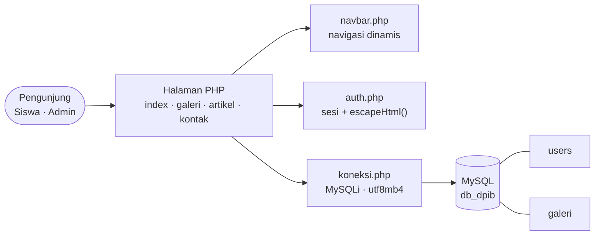
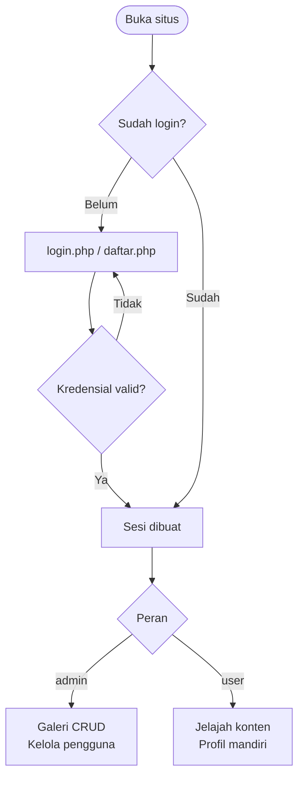
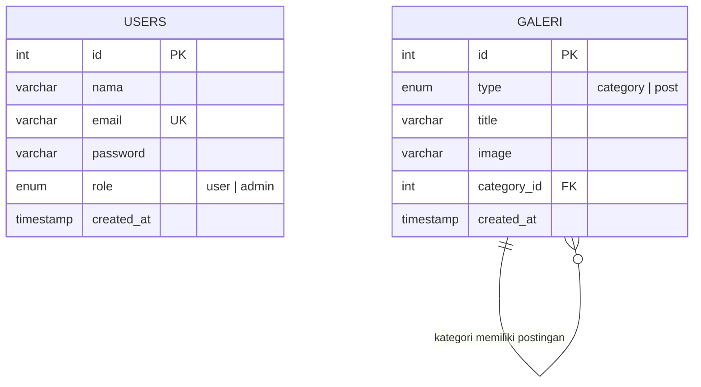

<div align="center">


### Portal Profil Jurusan dan Sistem Informasi Portofolio Siswa

*Presisi desain arsitektural, dipublikasikan untuk dunia.*

<br/>


<br/>

[Ringkasan](#ringkasan-proyek) &nbsp;•&nbsp;
[Fitur](#fitur-utama) &nbsp;•&nbsp;
[Arsitektur](#arsitektur-sistem) &nbsp;•&nbsp;
[Teknologi](#teknologi) &nbsp;•&nbsp;
[Instalasi](#instalasi) &nbsp;•&nbsp;
[Database](#skema-database) &nbsp;•&nbsp;
[Keamanan](#keamanan) &nbsp;•&nbsp;
[Roadmap](#roadmap) &nbsp;•&nbsp;
[Kontribusi](#kontribusi)

</div>

<br/>

---

## Ringkasan Proyek

**DPIB Web Portal** adalah aplikasi web dinamis untuk mempublikasikan profil, kompetensi keahlian, kurikulum industri, dan portofolio karya siswa jurusan **Desain Pemodelan dan Informasi Bangunan (DPIB)** di **SMK Negeri 1 Kawali**.

Antarmukanya mengusung gaya *architectural minimalism*. Di baliknya ada backend **PHP Native** dan **MySQL** yang menyediakan manajemen konten galeri (CRUD), akses bertingkat berbasis peran (*role-based access control*), dan portal wawasan teknologi konstruksi seperti *Building Information Modeling* (BIM).

<table>
  <tr>
    <td align="center" width="33%">
      <b>Etalase Jurusan</b><br/>
      <sub>Visi, misi, fasilitas, dan software industri yang dikuasai siswa, ditampilkan dalam satu beranda yang rapi.</sub>
    </td>
    <td align="center" width="33%">
      <b>Portofolio Dinamis</b><br/>
      <sub>Galeri karya dengan filter kategori real-time. Admin mengelola konten langsung dari halaman.</sub>
    </td>
    <td align="center" width="33%">
      <b>Akses Terkendali</b><br/>
      <sub>Autentikasi berbasis sesi, peran <code>admin</code> dan <code>user</code>, serta kueri aman berbasis prepared statements.</sub>
    </td>
  </tr>
</table>

---

## Fitur Utama

| Modul | Berkas | Deskripsi |
| :--- | :--- | :--- |
| **Beranda Interaktif** | `index.php` | Hero dengan call-to-action, profil jurusan dan filosofi, visi misi serta orientasi lulusan berstandar DUDI. Menampilkan *software suite* (AutoCAD, Revit, SketchUp, ArchiCAD) dan fasilitas studio gambar, lab komputer CAD/BIM, serta instrumen ukur tanah (*Total Station*). |
| **Galeri Portofolio** | `galeri.php` | *Masonry grid* responsif untuk desain 2D, rendering 3D, dan maket fisik. Filter kategori real-time (*3D Modeling*, *Desain Interior*, *Gambar Kerja*, *Maket*). Admin dapat menambah, mengubah, dan menghapus postingan serta mengelola kategori langsung di halaman. |
| **Wawasan Konstruksi** | `artikel.php` | Sorotan artikel utama (misalnya BIM Level 3 pada proyek infrastruktur), katalog artikel edukatif tentang modeling BIM, *green building*, dan workshop pengukuran lahan, dilengkapi sidebar pencarian, filter kategori, dan daftar postingan terbaru. |
| **Pusat Kontak** | `kontak.php` | Formulir pesan untuk calon siswa, wali murid, dan mitra industri, plus alamat resmi, telepon, surel institusi, dan jam operasional. |
| **Autentikasi** | `auth.php` `login.php` `daftar.php` `logout.php` | Pendaftaran mandiri dengan validasi format email, kata sandi minimal 8 karakter, dan konfirmasi kata sandi. Sesi terpusat serta helper `escapeHtml()` berbasis `htmlspecialchars` untuk mitigasi XSS. |
| **Navigasi Cerdas** | `navbar.php` | Header responsif yang mendeteksi status login, menampilkan avatar inisial pengguna, tautan cepat dashboard admin, dan akses keluar. |
| **Manajemen Pengguna** | `admin-users.php` `admin-user-edit.php` | Tabel seluruh akun beserta perannya. Admin dapat mengubah nama, surel, kata sandi, dan peran akun melalui *MySQLi Prepared Statements*. |
| **Pengaturan Akun** | `profil.php` | Pengguna memperbarui nama tampilan atau mengganti kata sandi secara mandiri kapan saja. |

---

## Arsitektur Sistem

Setiap halaman memakai tiga komponen bersama: `navbar.php` untuk navigasi, `auth.php` untuk sesi dan sanitasi, dan `koneksi.php` untuk koneksi database.



### Alur Akses Pengguna



### Peran dan Hak Akses

| Kemampuan | Pengunjung | User | Admin |
| :--- | :---: | :---: | :---: |
| Melihat beranda, galeri, artikel, dan kontak | ✅ | ✅ | ✅ |
| Mendaftar dan masuk | ✅ | — | — |
| Memperbarui profil dan kata sandi sendiri | ❌ | ✅ | ✅ |
| Menambah, mengubah, dan menghapus postingan galeri | ❌ | ❌ | ✅ |
| Mengelola kategori galeri | ❌ | ❌ | ✅ |
| Melihat dan mengedit seluruh akun pengguna | ❌ | ❌ | ✅ |

---

## Teknologi

| Layer | Komponen | Peran |
| :--- | :--- | :--- |
| **Backend** | PHP 8.0+ Native | Skrip sisi server, manajemen sesi, dan logika bisnis |
| **Database** | MySQL / MariaDB | Penyimpanan relasional data pengguna dan galeri (`db_dpib`) |
| **Driver** | MySQLi (Prepared Statements) | Kueri terparameterisasi untuk mencegah SQL Injection |
| **Styling** | Tailwind CSS (CDN Play) | Utilitas CSS modern dengan palet monokromatik bergaya arsitektur |
| **Ikon** | Google Material Symbols Outlined | Ikon antarmuka yang bersih dan konsisten |
| **Tipografi** | Inter dan JetBrains Mono | Sans-serif elegan berpadu monospace teknis ala *blueprint* |
| **Encoding** | `utf8mb4` | Set karakter universal untuk data teks |

---

## Instalasi

### Prasyarat

- Web server dan database: **XAMPP**, **Laragon**, atau stack LAMP/MAMP dengan **PHP 8.0+**
- Layanan **MySQL / MariaDB** aktif di port `3306`
- **Git** (opsional, untuk kloning)
- Peramban modern: Chrome, Firefox, atau Edge

### Langkah 1: Unduh proyek

```bash
git clone https://github.com/hamdandzrpl/DPIB-projects.git
```

Letakkan folder hasil kloning di direktori publik web server:

| Stack | Lokasi |
| :--- | :--- |
| XAMPP | `C:/xampp/htdocs/DPIB-projects` |
| Laragon | `C:/laragon/www/DPIB-projects` |

### Langkah 2: Impor database

1. Buka phpMyAdmin di `http://localhost/phpmyadmin`.
2. Buka tab **SQL**, salin kueri dari bagian [Skema Database](#skema-database), lalu jalankan.

Kueri tersebut sudah membuat database `db_dpib`, tabel, dan data awal.

### Langkah 3: Sesuaikan koneksi

Periksa `koneksi.php` di root proyek dan sesuaikan dengan server lokal Anda:

```php
<?php
// Koneksi database MySQL
$host = "localhost";
$user = "root";
$pass = "";
$db   = "db_dpib";

$conn = mysqli_connect($host, $user, $pass, $db);

if (!$conn) {
    die("Koneksi gagal: " . mysqli_connect_error());
}

mysqli_set_charset($conn, "utf8mb4");
```

### Langkah 4: Jalankan

```text
http://localhost/DPIB-projects/index.php
```

> [!TIP]
> **Tanpa XAMPP atau Laragon?** Jalankan PHP built-in server dari folder proyek:
> ```bash
> php -S localhost:8000
> ```
> Lalu buka `http://localhost:8000/index.php`.

### Akun uji coba

| Peran | Surel | Kata sandi | Hak akses |
| :--- | :--- | :--- | :--- |
| **Administrator** | `admin@dpib.sch.id` | `admin123` | Penuh: kelola galeri, kategori, dan semua akun |
| **Siswa** | `siswa@dpib.sch.id` | `siswa123` | Jelajah konten dan perbarui profil sendiri |

> [!WARNING]
> Akun di atas hanya untuk pengembangan lokal. **Ganti atau hapus** sebelum aplikasi dipublikasikan.

### Pemecahan masalah

| Gejala | Penyebab umum | Solusi |
| :--- | :--- | :--- |
| `Koneksi gagal: ...` | MySQL belum berjalan atau kredensial salah | Nyalakan MySQL di panel XAMPP/Laragon, lalu cek `koneksi.php` |
| `Unknown database 'db_dpib'` | Database belum diimpor | Jalankan ulang kueri di [Skema Database](#skema-database) |
| Gambar galeri tidak tampil | Berkas tidak ada atau nama tidak cocok | Pastikan berkas ada di `assets/` dan sama persis dengan kolom `image`, termasuk spasi seperti pada `dpib 2.jpg` |
| Port `3306` atau `80` bentrok | Layanan lain memakai port yang sama | Ubah port di panel XAMPP/Laragon, atau pakai `php -S localhost:8000` |

---

## Skema Database

Proyek ini memakai dua tabel pada database `db_dpib`. Tabel `galeri` menyimpan kategori dan postingan sekaligus lewat relasi *self-referencing*: kolom `type` membedakan keduanya, dan `category_id` pada postingan menunjuk ke baris kategori.



<details>
<summary><b>Lihat kueri SQL lengkap (skema dan data awal)</b></summary>

<br/>

```sql
-- 1. Pembuatan Database
CREATE DATABASE IF NOT EXISTS db_dpib
  CHARACTER SET utf8mb4
  COLLATE utf8mb4_unicode_ci;

USE db_dpib;

-- 2. Tabel Pengguna (users)
CREATE TABLE IF NOT EXISTS users (
    id INT AUTO_INCREMENT PRIMARY KEY,
    nama VARCHAR(100) NOT NULL,
    email VARCHAR(100) NOT NULL UNIQUE,
    password VARCHAR(255) NOT NULL,
    role ENUM('user', 'admin') NOT NULL DEFAULT 'user',
    created_at TIMESTAMP DEFAULT CURRENT_TIMESTAMP
) ENGINE=InnoDB DEFAULT CHARSET=utf8mb4;

-- 3. Tabel Galeri & Kategori (galeri)
CREATE TABLE IF NOT EXISTS galeri (
    id INT AUTO_INCREMENT PRIMARY KEY,
    type ENUM('category', 'post') NOT NULL,
    title VARCHAR(255) NOT NULL,
    image VARCHAR(2048) NULL,
    category_id INT NULL,
    created_at TIMESTAMP DEFAULT CURRENT_TIMESTAMP,
    INDEX idx_type (type),
    INDEX idx_category (category_id),
    CONSTRAINT fk_galeri_category
      FOREIGN KEY (category_id)
      REFERENCES galeri(id)
      ON DELETE SET NULL
      ON UPDATE CASCADE
) ENGINE=InnoDB DEFAULT CHARSET=utf8mb4;

-- 4. Data Benih Awal (Seeding)
-- User Default
INSERT INTO users (nama, email, password, role) VALUES
('Administrator DPIB', 'admin@dpib.sch.id', 'admin123', 'admin'),
('Siswa Contoh', 'siswa@dpib.sch.id', 'siswa123', 'user')
ON DUPLICATE KEY UPDATE id=id;

-- Kategori Galeri
INSERT INTO galeri (id, type, title) VALUES
(1, 'category', 'Desain 3D & BIM'),
(2, 'category', 'Gambar Kerja 2D'),
(3, 'category', 'Maket Arsitektur')
ON DUPLICATE KEY UPDATE title=VALUES(title);

-- Contoh Postingan Karya
INSERT INTO galeri (type, title, image, category_id) VALUES
('post', 'Desain Rumah Tinggal Tropis Modern', 'dpib1.jpg', 1),
('post', 'Perencanaan Denah dan Potongan Gedung', 'dpib 2.jpg', 2),
('post', 'Maket Kompleks Hunian Ramah Lingkungan', 'dpib 3.jpg', 3);
```

</details>

---

## Struktur Proyek

```text
DPIB-projects/
├── index.php             # Beranda: profil jurusan, visi misi, software, fasilitas
├── galeri.php            # Galeri interaktif dengan filter dan panel CRUD admin
├── artikel.php           # Portal artikel dan wawasan teknologi konstruksi
├── kontak.php            # Kontak, formulir pesan, dan lokasi sekolah
│
├── login.php             # Form dan logika login
├── daftar.php            # Form dan pemrosesan pendaftaran akun
├── logout.php            # Penghancuran sesi dan pengalihan ke halaman masuk
├── profil.php            # Pembaruan nama dan kata sandi mandiri
│
├── admin-users.php       # Daftar seluruh akun pengguna (admin)
├── admin-user-edit.php   # Edit data dan peran akun (admin)
│
├── auth.php              # Inisiasi sesi PHP dan sanitasi (escapeHtml)
├── koneksi.php           # Konfigurasi koneksi MySQLi terpusat
├── navbar.php            # Komponen navigasi universal dengan avatar profil
│
├── assets/               # Gambar karya siswa, logo, dan aset visual
└── README.md             # Dokumentasi proyek
```

---

## Keamanan

| Aspek | Status | Keterangan |
| :--- | :---: | :--- |
| SQL Injection | ✅ | Kueri memakai MySQLi Prepared Statements |
| XSS | ✅ | Keluaran disanitasi lewat `escapeHtml()` (`htmlspecialchars`) |
| Kontrol akses | ✅ | Pembatasan halaman dan aksi berdasarkan peran `admin` dan `user` |
| Penyimpanan kata sandi | ⚠️ | Masih *plaintext*, perlu `password_hash()` |
| Proteksi CSRF | ⚠️ | Belum ada token anti-CSRF pada formulir POST |
| Unggah berkas | ⚠️ | Belum ada handler unggah dengan validasi MIME dan batas ukuran |

> [!IMPORTANT]
> Proyek ini dikembangkan untuk pembelajaran dan tugas kejuruan Rekayasa Perangkat Lunak (RPL). Sebelum dipakai di server produksi, terapkan peningkatan berikut.

**1. Hash kata sandi**

```php
// Saat mendaftar atau mengubah kata sandi
$hash = password_hash($password, PASSWORD_BCRYPT);

// Saat login
if (password_verify($inputPassword, $row['password'])) {
    // kredensial valid
}
```

> [!NOTE]
> Setelah memakai hashing, perbarui juga data awal akun uji coba di `users`, karena nilai `admin123` dan `siswa123` di seed masih berupa teks biasa.

**2. Token CSRF** pada setiap formulir POST untuk mencegah pengiriman data lintas situs.

**3. Unggah berkas yang aman:** validasi tipe MIME biner, batas ukuran, dan penamaan hash acak saat foto karya diunggah ke server.

**4. Pagination galeri** (halaman atau *infinite scroll*) ketika jumlah karya makin banyak.

---

## Roadmap

- [x] Antarmuka responsif modern berbasis Tailwind CSS
- [x] Autentikasi pengguna dengan session PHP
- [x] Manajemen galeri dan kategori dinamis (CRUD admin)
- [x] Kontrol akses multi-peran (`admin` dan `user`)
- [x] Modul pembaruan profil mandiri
- [ ] Hashing kata sandi (`password_hash` dan `password_verify`)
- [ ] Unggah langsung berkas gambar karya ke server
- [ ] Artikel berbasis database dengan rich text editor (WYSIWYG)
- [ ] Testimoni alumni dan mitra industri DUDI
- [ ] Optimasi SEO (OpenGraph tags, sitemap, meta schema)

Punya ide fitur lain? Silakan [buka issue](https://github.com/hamdandzrpl/DPIB-projects/issues).

---

## Kontribusi

Kontribusi sangat diterima, baik perbaikan bug, peningkatan keamanan, maupun fitur baru dari roadmap.

1. **Fork** repositori ini.
2. Buat branch fitur: `git checkout -b feat/nama-fitur`
3. Commit perubahan dengan pesan yang jelas: `git commit -m "feat: tambah handler unggah gambar"`
4. Push ke branch: `git push origin feat/nama-fitur`
5. Buka **Pull Request** dan jelaskan perubahan Anda.

| Prefiks commit | Dipakai untuk |
| :--- | :--- |
| `feat:` | Fitur baru |
| `fix:` | Perbaikan bug |
| `docs:` | Perubahan dokumentasi |
| `refactor:` | Perapian kode tanpa mengubah perilaku |
| `security:` | Peningkatan keamanan |

---

## Pengembang

<table>
  <tr>
    <td align="center">
      <a href="https://github.com/hamdandzrpl">
        <br/>
        <b>Hamdan Dzakir</b>
      </a><br/>
      <sub>Siswa Rekayasa Perangkat Lunak (RPL)<br/>SMK Negeri 1 Kawali</sub><br/>
      <a href="https://github.com/hamdandzrpl">@hamdandzrpl</a> &nbsp;•&nbsp;
      <a href="https://tkj-smknn1kawali.vercel.app">Situs</a>
    </td>
  </tr>
</table>

---

## Lisensi

Didistribusikan di bawah **MIT License**. Terbuka untuk digunakan, dimodifikasi, dan dikembangkan kembali untuk keperluan edukasi dan kemajuan dunia vokasi. Lihat berkas `LICENSE` untuk detailnya.

<!--
  TANGKAPAN LAYAR (opsional)
  1. Simpan gambar di folder assets/screenshots/ (misal beranda.png, galeri.png).
  2. Hapus tanda komentar di bawah ini, lalu letakkan bagian ini setelah "Ringkasan Proyek".

  ## Tampilan Antarmuka

  | Beranda | Galeri |
  | :---: | :---: |
  |  |  |
-->

<br/>

<div align="center">

<sub>Dibangun dengan bangga untuk memajukan talenta vokasi teknik dan teknologi di SMKN 1 Kawali.</sub>


</div>
